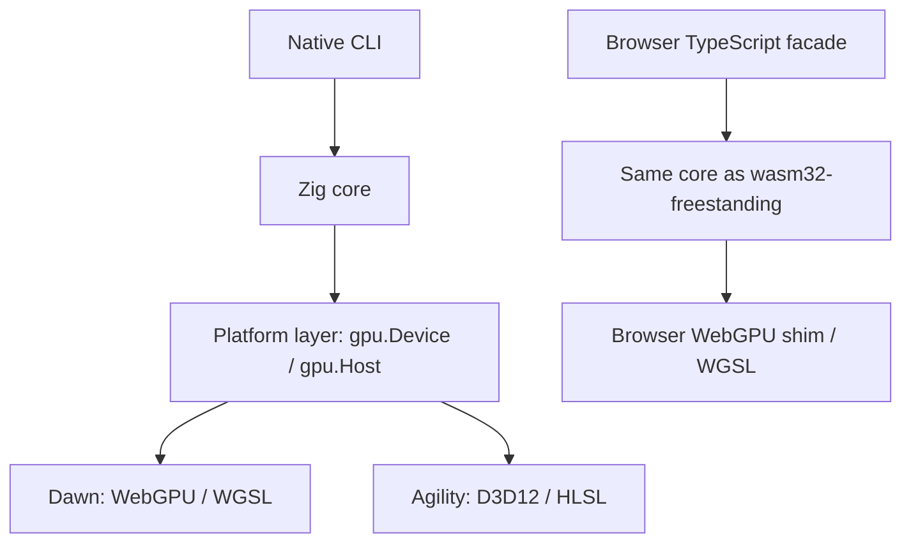
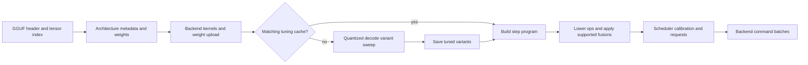
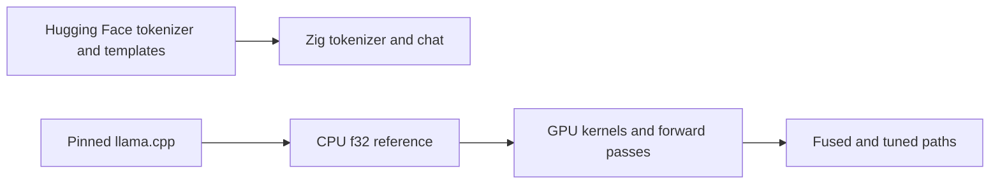

# Architecture

zllm is a portable inference engine with one Zig core and a platform backend
layer. Its aim is to produce tokens as fast and as accurately as the hardware
allows on supported platforms. Portability does not require identical shader
code: the graph, plans, scheduler, sampler, fusion legality and tuner are
shared; backends supply kernels and execute commands.

`src/backend/backend.zig` defines the implemented backend identities:
`webgpu` and `agility`. Native code uses `src/gpu/host.zig` to open a device,
read its limits and adapter identity, and execute batches without reaching
into Dawn or D3D12. The browser implements the WebGPU side in
`web/src/zllm/gpu.ts`. See the [backend capability matrix](backends.md)
for supported paths and gaps.

## Load pipeline

The native runtime in `src/generate.zig` and the wasm runtime in
`src/api/wasm.zig` follow this order. Weight data is uploaded through
`write_file`; the browser core needs the GGUF header rather than a copy of
all weights. Tuning uses uploaded weights before the step program is built.
The current pipeline does not run a second tuning pass after fusion.

The plan cache stores tuning choices, not serialized GPU objects, compiled
shaders or complete execution plans. Each load still creates pipelines,
uploads weights and builds its program.

## Modules

These modules are implemented. Their scope is defined by the source, not by
whether every item in the [design specification](spec.md) is complete.

| Module | Current role |
|---|---|
| `gguf` | Parses the GGUF header, metadata and tensor index over borrowed bytes |
| `tokenizer` | GGUF byte-level BPE, model-specific pre-tokenizers, NFC where required, special tokens and streaming decode |
| `graph` | Architecture metadata and layer schedules for Qwen 3.5, Qwen3.8-Flash-Next (`qwen4exp`), and supported Qwen 3, Llama and Granite dense models |
| `ref` | CPU f32 dequantization and forward passes used as correctness oracles and by diagnostic commands; not an automatic CPU inference fallback |
| `tmpl` | Handlebars-subset renderer for hand-written kernel templates |
| `kernels` | Kernel identities, parameter structs, binding contracts, WGSL implementations, variants and launch construction |
| `backend` | Implemented backend identities and the shared backend contract |
| `gpu` | Command recorder, native platform interface, Dawn device and host, and shared profiling results |
| `agility` | Windows D3D12 host, DirectStorage and hand-written HLSL implementations |
| `tune` | Non-blocking load-time sweep of quantized decode multiply variants, checked against the default before timing |
| `fuse` | Buffer-use legality and lowering for the implemented `hc_act` → quantized decode multiply fusion |
| `plan` | Weight layout and upload, activation and state buffers, prebuilt launches, architecture-neutral `Model`/`Program`, and tuning-cache serialization |
| `sched` | Request state machine, budgeted steps, calibrated prefill, decode, speculation where supported, cancellation and streaming |
| `state` | Resident sequence, checkpoint slots and prefix reuse |
| `sampler` | Sampling parameters, random draws and the CPU reference sampler; GPU sampling kernels live in `kernels` |
| `chat` | Fixed Qwen text template, a Zig Jinja interpreter for other models' GGUF templates, messages and tool-call formats |
| `api` | wasm exports consumed by the TypeScript facade in `web/src/zllm`; no built native C ABI |

`plan.Model` and `plan.Program` dispatch by architecture. The Qwen 3.5
program also handles the supported dense attention-only models. The
Qwen3.8-Flash-Next program shares upload and launch helpers but has its own
sparse attention, routed experts, hyper-connections and file-read PLE rows.

The fuser is a real pass, but not a general graph optimizer. It currently
handles a small operation graph around Gyro-Coder's hyper-connection
activation. Other fusions, such as stacked projections, RMSNorm prologues
and residual adds, are constructed directly by the plans. See
[Fusion](gpu.md#fusion).

## Async model

The core is a state machine driven by its host:

1. The host supplies a request, completion or cancellation.
2. The core advances and records commands to create objects, write buffers,
   dispatch kernels, submit work and read results.
3. The host executes the batch and reports completions carrying the tokens
   of the `submit` and `read_buffer` operations they answer.

The core does not block on a GPU API and uses no Asyncify. Browser WebGPU
promises feed completions back into wasm. The native Dawn and Agility hosts
can block on a submission and deliver completions immediately. Both drive
the same scheduler and program interface.

A batch is a flat stream of `u32` words
([command stream](gpu.md#command-stream)), so the browser crosses the
wasm/JS boundary once per batch rather than once per dispatch. Kernel
creation records an identity, variant and binding write set as well as a
backend-specific artifact. A shared kernel contract does not require the
backends to use the same optimization strategy.

Resident sequence and GPU state belong to a device. Recovery rebuilds the
backend resources and program, reuses cached tuning when available, and
drops the resident sequence; it does not resume a partially completed turn.
See [Device lost](gpu.md#device-lost).

## Reference-first validation

Every optimized path needs an oracle:

The repository checks individual kernels, full forward passes, step splits,
sampling, speculation, prefix reuse, fusion and recovery. Backend-specific
implementations retain the same parameter and binding contracts and are
checked against the same reference computations. Numerical agreement is
defined per gate: some comparisons are bitwise, while others allow the
rounding changes introduced by reductions or cache formats. See
[Validation](validation.md).
