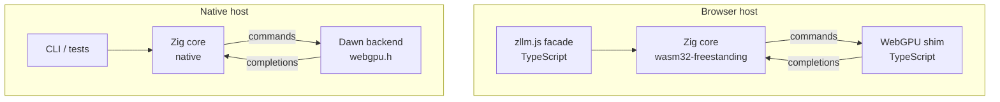
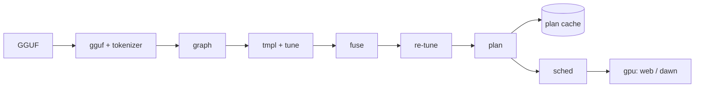
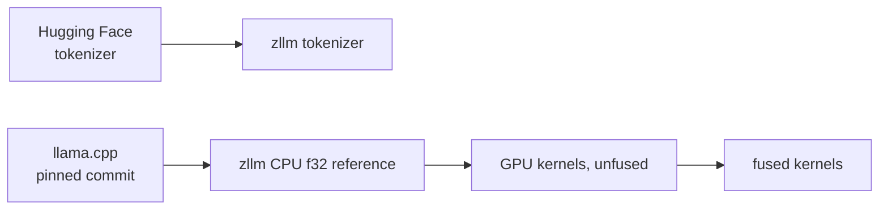

# Architecture

zllm is one Zig core with two thin hosts. The core never blocks, never
allocates GPU objects itself, and never knows whether it is running in a
browser tab or a native test process.

## Load pipeline

## Modules

Each directory under `src/` is one module from the spec's component table.
Modules not yet started contain only a `README.md` stating their contract.

| Module | Milestone | Role |
|---|---|---|
| `gguf` | M0 | Zero-copy GGUF header, metadata and tensor index over a borrowed byte slice (mmap or staged prefix) |
| `tokenizer` | M0 | Byte-level BPE built from `tokenizer.ggml.*` metadata |
| `graph` | M0 | Architecture hyperparameters and layer schedule from GGUF metadata |
| `ref` | M0 | Dequantization to f32 and the CPU f32 reference forward pass; the correctness oracle for every GPU kernel |
| `tmpl` | M4 | Handlebars-subset WGSL template renderer |
| `kernels` | M1 | WGSL compute kernels and their launch parameters; templates with schemas and cost models in M4 |
| `tune` | M4 | Load-time candidate sweeps |
| `fuse` | M5 | Graph fusion pass |
| `plan` | M1, M2 | Weight layout (row-chunked to fit bindings); the step program: buffers, state, prebuilt launches |
| `sched` | M2 | The engine: steps under the time budget, decode, stops, streaming |
| `state` | M2 | The resident sequence, checkpoint slots, prefix reuse |
| `sampler` | M2 | Sampling parameters, draws, the CPU reference sampler (the kernel is in `kernels`) |
| `chat` | M2 | The fixed Qwen chat template for text conversations |
| `gpu` | M1 | Command stream, Dawn host (`webgpu.h` loaded at run time); browser host in M3 |
| `api` | M3 | C ABI, wasm exports, TypeScript facade |

`ref` is not in the spec's table: the spec rules out a CPU inference path in
v1 but requires a CPU f32 reference for validation. It lives in its own module
so that nothing outside tests depends on it.

`chat` is not in the table either. In the browser, the JavaScript facade
renders chat templates with `@huggingface/jinja`; the native command line has
no Jinja, so it carries one fixed template, checked against the Jinja
original.

## Async model

The core is a state machine driven by its host:

1. The host calls into the core with an input (a request, a completion, a cancel).
2. The core advances and returns a batch of **commands**: create buffer, write
   buffer, dispatch, submit, read back.
3. The host executes them and later reports **completions** carrying the
   token of the `submit` or `read` they answer.

There is no blocking and no Asyncify. The browser shim resolves WebGPU promises
and feeds completions back; the Dawn backend may simply block and feed them back
immediately. Both hosts drive the identical core state machine, so native tests
exercise the browser control flow.

A batch is a flat stream of `u32` words ([GPU backend](gpu.md#command-stream))
that the host interprets in one call, so the browser crosses the wasm/JS
boundary once per batch instead of once per dispatch. Engine epochs on
completions (so a callback that arrives after unload or device loss is
recognized as stale) come with the asynchronous browser host in M3.

## Reference-first validation

Every layer of the stack is checked against the layer below it:

M0 built the left half: the tokenizer against Hugging Face and the CPU
reference against llama.cpp. M1 checks every GPU kernel, and the whole GPU
forward pass, against the CPU reference. See [Validation](validation.md).
