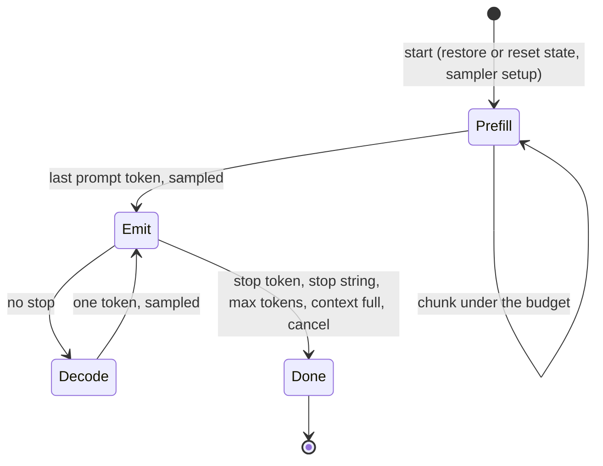

# Generation

M2 turns the GPU forward pass into text generation: an engine that schedules
steps under a time budget, keeps the model's state between requests, samples
on the GPU, and streams text. `zllm chat` and `zllm generate` drive it on the
Dawn host.

```sh
zllm chat model.gguf                        # thinking on; --no-think to skip it
zllm chat model.gguf --system "Be brief." --temperature 0.7
zllm generate model.gguf "Once upon a time" --max-tokens 200 --seed 1
scripts/d3d12.sh chat 'C:\path\to\model.gguf'   # on the Windows GPU, from WSL
```

## Engine

`src/sched/sched.zig` is a state machine that never blocks. Its host calls
`start` with a request, then repeatedly `next`, which returns one of four
events:

- **`submit`:** execute this batch, then call `complete` with its GPU time.
- **`token`:** a sampled token and the text it released.
- **`wait`:** complete the oldest outstanding batch first.
- **`done`:** the finish reason (`stop`, `length` or `abort`) and usage.

The native host executes and completes each batch before calling `next`
again, so it never sees `wait`. The browser host executes asynchronously
and keeps two batches in flight: decoding records the next step before the
previous step's token is read back, since the sampler hands each token to
the next step on the GPU. The resident sequence holds a placeholder until
the token arrives. When a step ends the request, the step after it has
already processed the final token, which stays resident; that step's own
sample is discarded. This hides Chrome's readback latency
([Browser](browser.md#two-steps-in-flight)).

`cancel` ends a request after the batch in flight: `done` reports `abort`,
and the tokens processed so far stay resident, so the next request reuses
them as after any other finish.



## Scheduling

Every submission is one step, and every step aims for the spec's 150 ms
budget:

- **Prefill:** a chunk is the largest token count whose predicted cost fits
  90% of the budget, at most 512. The prediction is linear,
  fixed + per_token · m:
  - **Fixed part:** measured on one-token steps. Before the first request,
    the host runs two calibration steps on a scratch state; the first only
    warms up the pipelines.
  - **Per-token part:** taken from the latest prefill step, because it grows
    with position (attention). That growth is also why the target is 90%.
  - **Ramp:** a chunk grows at most 4× past the step its rate came from,
    since the rate also rises with the chunk size. Before any prefill step
    has been measured, the first chunk is as many tokens as one-token steps
    fit in 90% of the budget, at most 64. A prefill token never costs more
    than a whole decode step, so this holds even for the 27B, whose
    one-token step is far slower.
- **Slow GPUs:** where a one-token step alone takes more than half the
  budget, smaller chunks would only add steps that each pay that cost. The
  target becomes twice the fixed cost instead. On llvmpipe, where one step
  costs about a second, the plain rule cut chunks to one or two tokens.
- **Tiles:** the prefill multiplies compute whole tiles of tokens (16 for
  BF16 weights, 32 for quantized ones), and a partial tile costs as much as
  a whole one. So the per-token rate counts a step's tokens in whole tiles,
  and chunks are whole tiles. Where not even one tile fits the target, the
  chunk is one tile as long as its prediction stays under 90% of the
  spec's 250 ms hard cap. The 27B's 32-token steps take about 116 ms; with
  8-token chunks, each step cost as much as a whole tile and prefill ran
  at 25 tok/s.
- **Checkpoint boundaries:** chunks also end at multiples of 512 and just
  before the prompt's last token. That token then runs as its own step, which
  measures the fixed cost and produces the logits to sample.
- **Alignment:** otherwise chunks end only at multiples of 8, or of the
  program's longest step where that is shorter (4 for Qwen3.8-Flash-Next).
  The alignment was 64 until the 27B: its 64-token steps alone took
  seconds, past Windows' 2 s GPU watchdog.
- **Kernels:** every prefill chunk runs the prefill kernels, however few
  tokens it has, and only the prompt's last token takes the decode kernels,
  which round differently ([GPU backend](gpu.md#two-kernel-paths)). The
  prefill kernels give the same result however a prompt is split, so the
  kernels each prompt position goes through depend on the prompt alone, not
  on step timings. Steps of a few tokens used to take the decode kernels by
  their size, and the chunk just before the last token can be a short tail:
  whether it ran alone depended on where timing had put the previous
  boundary.
- **Decode:** one token per step. The sampler writes the token straight into
  the next step's input on the GPU, so the CPU only reads back the token id
  and its stop flag. Qwen3.8-Flash-Next cannot work that way: the host picks
  each token's per-layer embedding rows from the file
  ([GPU backend](gpu.md#qwen38-flash-next)), so it must know the token
  before the step. Its decode steps run one batch at a time, each processing
  the token read back (`plan.Program.chainsSamples`).

## Speculative decoding

Qwen 3.8's GGUFs carry a multi-token prediction (MTP) block: from position
i's final hidden state and token i + 1, it drafts token i + 2
([Qwen 3.5](qwen35.md)). With it, each decode round is one batch:

1. **Roll back** if the previous round's draft was rejected: copy the kept
   DeltaNet state back and uncount the discarded sample.
2. **Draft:** the MTP block over the last step's positions (its own KV cache
   gets their rows), then the head and an argmax over the last row, into
   the next step's input on the GPU.
3. **Verify:** the sampled token and the draft in one two-position step,
   keeping the state after the token, and a sample at both positions with
   consecutive draws.

The draft is accepted when the first sample equals it. Then both samples
are emitted; otherwise only the first, and the second's draw goes to the
next sample. Every emitted token is the model's own sample with the draw it
would get without speculation, and the decode kernels give each row the
same result in a step of two as in a step of one, so the output is
bitwise the same, for any sampling settings, penalties included
([Validation](validation.md#engine)). Prefill also runs the MTP block over
each chunk, so drafts see the whole prompt.

```mermaid
stateDiagram-v2
  [*] --> Draft: last step's hidden states, sampled token
  Draft --> Verify: draft in the next step's input
  Verify --> Accepted: first sample = draft
  Verify --> Rejected: first sample ≠ draft
  Accepted --> Draft: emit both samples
  Rejected --> Draft: emit the first; roll back the draft's position
```



- **One batch at a time:** the next round's positions depend on the
  verdict, so rounds do not pipeline (see [Engine](#engine)).
- **Single-token steps:** where the two positions would include a
  checkpoint position, or the last sample `max_tokens` allows.
- **When it pays:** a round costs about a step plus a draft, which runs the
  MTP block and the whole output head. The engine speculates by default
  where the draft's weights are at most an eighth of the model's: the 27B,
  not the 0.8B, whose head alone is about 30% of its weights (there,
  speculating ran at 277 tok/s greedy against 276, and 232 sampled against
  265). `speculate` in a request, or `--speculate` and `--no-speculate`,
  override the default.

## State and prefix reuse

The resident sequence is every token the GPU has processed. The KV cache
holds their rows, and the DeltaNet state is the state after the last one.
`src/state/state.zig` decides how much of a new prompt to reuse:

| Case | Action | Prefill |
|---|---|---|
| The resident sequence is a prefix of the prompt | Continue from the current state | The rest of the prompt |
| They share a prefix | Restore the latest checkpoint inside it | From the checkpoint |
| Nothing usable, or no resident sequence | Zero the DeltaNet state | The whole prompt |

- **Rewinding:** attention rows rewind for free, since rows past the
  sequence are never read. The DeltaNet state cannot rewind, so the engine
  copies it into one of 4 checkpoint slots every 512 tokens and just before
  each prompt's last token, evicting the oldest slot when all are full.
- **The last-token checkpoint:** it serves three cases with one replayed
  token: regenerating the same prompt, editing what follows it, and
  continuing a conversation whose reply was re-rendered differently.

Reuse is exact where it can be. A reused prefix gives logits bitwise
identical to processing the whole prompt from scratch whenever both runs put
each position through the same kernels. That covers checkpoint restores, a
repeated prompt and a reset. One case differs: a prompt that extends a turn
reuses the reply's tokens, which went through the decode kernels, while a
fresh run would prefill them. There the logits agree within 1e-4 relative
L2, and 3e-5 is measured ([Validation](validation.md#engine)).

KV is one contiguous f16 cache per attention layer, sized for the context
(8192 tokens by default, 12 KiB per token for the 0.8B model). The spec's
256-token pages matter once several sequences share a pool, which a
single-sequence engine doesn't need.

## Sampling

The sampler (`src/kernels/sample.wgsl`) follows vLLM's v1 sampler
(`vllm-project/vllm@0c81a03`, `vllm/v1/sample/sampler.py`) step for step:

1. Logit bias.
2. Penalties:
   - Repetition: over prompt and output tokens, a logit l becomes l / r if
     positive, else l · r.
   - Frequency and presence: over output tokens only, l −= frequency · count
     + presence · [count > 0].
3. Greedy argmax (first index) if the temperature is below 1e-5.
4. Temperature.
5. Min-p: drop p < min_p · p_max.
6. Top-k: keep values ≥ the k-th largest.
7. Top-p: keep a token while the probability ranked above it is < p.
8. The draw.

Each filter keeps a top segment of the values, so the kept set is always one
threshold on order-preserving keys, combined with the min-p test. The kernel
runs in phases, one dispatch each, chosen per request:

| Phase | Workgroups | Work |
|---|---|---|
| prep | one per 1,024 tokens | Bias (binary search in a token-sorted list), penalties, temperature; each workgroup's maximum |
| reduce | 1 | The maximum and its first index; greedy finishes here |
| top-k | 4 × (one per 1,024 tokens, then 1) | Radix select: 8-bit histograms of the keys, then the digit holding the k-th largest |
| top-p, after a top-k of at most 1,024 | one per 1,024 tokens, then 1 | Gather the candidates, sort them in workgroup memory, cut at p, draw in token order |
| draw | one per 1,024 tokens, then 1 | Each workgroup's kept mass in token order, then the inverse CDF |
| top-p otherwise | 32 × (one per 1,024 tokens, then 1) | Bisection on the key threshold |

With the chat defaults (top-k 20, top-p 0.95) a draw is 12 dispatches and
0.2 ms on the RTX 5090. Stop tokens are checked on the GPU. Two differences
from vLLM, both deliberate:

- **Ties:** tokens tied at a top-k or top-p threshold are all kept. vLLM
  splits them by sort order.
- **Draw:** an inverse CDF in token-id order at one uniform u per step, drawn
  on the CPU from the request's seed. vLLM uses an exponential race, so
  seeded streams differ.

`src/sampler/sampler.zig` holds the request parameters, with vLLM's range
checks, and a CPU reference sampler that `gpu-check` compares the kernel
against.

What a request leaves unset takes the model's defaults
(`src/sampler/defaults.zig`), as vLLM takes a model's
`generation_config.json`. The base is the architecture's model card, for
chat: Qwen 3.5's text-task settings for its architecture (Qwen 3.5, 3.6 and
3.8 dense), plain sampling for any other:

| Mode | Temperature | top_p | top_k | Presence penalty |
|---|---|---|---|---|
| Thinking | 1.0 | 0.95 | 20 | 1.5 |
| `--no-think` | 1.0 | 1.0 | 20 | 2.0 |

The GGUF's own recommendation, llama.cpp's `general.sampling.*` keys,
replaces the fields it sets, in either mode, and raw continuations
(`generate`) take it over plain sampling. zllm takes temp, top_k, top_p,
min_p and penalty_repeat; it ignores the other keys (penalty_last_n,
xtc_*, mirostat*) and values outside the sampler's range. The 27B's GGUF
recommends temperature 1, top_k 20 and top_p 0.95; so does the
Gyro-Coder's, whose architecture has no card: its chat takes no presence
penalty. With the Qwen card's 2.0 (no reasoning block), its code came out
with stray quotes, the penalty steering it off tokens code repeats.

## Chat format

For Qwen 3.5–3.8 and the Gyro-Coder, `zllm chat` formats conversations with
the fixed Qwen chat template,
[froggeric/Qwen-Fixed-Chat-Templates](https://huggingface.co/froggeric/Qwen-Fixed-Chat-Templates)
@ `855bffc4`, v22.5. `src/chat/chat.zig` transcribes it for text
conversations with its default options, including:

- **Thinking control:** the `enable_thinking` and `reasoning_effort`
  options, and `<|think_off|>`-style tags in system and user messages.
- **Reasoning:** split out of earlier replies or passed separately.
- **System prompts:** leading system messages merged into one.
- **Whitespace:** trimmed like Python's `str.strip`.
- **Tools:** the functions offered, in the system turn; calls in the
  XML format; tool responses grouped into one user turn, with the
  template's warnings after tool errors. Tools and arguments are written
  as `transformers`' `tojson` writes them. Numbers keep the spelling they
  were sent with, which matches except where Python would normalize it
  (`1E2`, `1.50`).

`check-chat` compares the transcription with the Jinja template, rendered as
Hugging Face `transformers` renders it.

Other models use their own template from the GGUF, through zllm's Jinja
interpreter ([Dense transformers](dense.md#chat)).

The template keeps earlier turns' reasoning (`preserve_thinking`), which
matters for reuse. Each new prompt re-renders the previous reply exactly as
the model generated it, so the whole conversation stays resident, and a turn
prefills only the new message. The stock Qwen template drops old reasoning,
which would force recomputing every earlier reply.

Text streams through `src/tokenizer/stream.zig`. It holds back bytes until
they form complete UTF-8 and cannot be the start of a stop string. The stop
string itself is not output, as in vLLM by default.

## Performance

Measured with `zllm generate` on an RTX 5090 Laptop (D3D12), f16 KV:

| Phase | M2 | Now |
|---|---|---|
| Prefill, a 2,457-token prompt | 1,562–1,567 tok/s | 2,882–2,896 tok/s, in 12 steps |
| Decode, greedy, short context | 34 tok/s | 285–295 tok/s |
| Decode, greedy, after the 2,457-token prompt | 27 tok/s | 270 tok/s |
| Decode, top-k 20 + top-p 0.95 | 25 tok/s | 268 tok/s |

`zllm bench` attributes a decode step to kernel classes by ablation: the
step replayed without each class. It drove the decode kernels and their
fusion, step by step, at position 1,056:

| Change | ms per decode step |
|---|---|
| M2 kernels | 42.6 |
| Matrix-vector multiplies for decode (23.7 → 2.0 ms) | 18.9 |
| Sampler in phases across the GPU (10.6 → 0.2 ms) | 8.1 |
| Decode attention split over cache blocks (3.0 → 0.45 ms) | 5.7 |
| DeltaNet state in registers (1.2 → 0.35 ms) | 5.0 |
| Matrix-vector activations in workgroup memory | 4.8–4.9 |
| Decode attention reads V once per GQA group (0.66 → 0.34–0.40 ms) | 4.7 |
| Fusion: 441 → 182 dispatches per step ([GPU backend](gpu.md#fusion)) | 3.9 |

What remains, of about 3.9 ms per step:

- **Weights:** a decode step streams 1.5 GB of BF16 weights, about 1.7 ms
  at this GPU's bandwidth. The vocabulary projection runs at that floor
  (0.5 GB in 0.54 ms). The body's projections reach about 60% of it (1.0 GB
  in 1.7 ms), so they are the next lever.
- **Dispatches:** each dependent dispatch costs 2.4–3.8 µs on this GPU
  through D3D12, depending on its work, so the 182 cost 0.4–0.7 ms.
- **Attention and the sampler:** about 0.3 and 0.2 ms.

Synchronizing a submission costs 0.1–0.2 ms.

### The 27B

Qwen 3.8 27B at Q3_K_M (13.75 GB) on the same GPU, `zllm generate`, greedy:

| Phase | First run | Now | Spec bar |
|---|---|---|---|
| Prefill, a 901-token prompt | 25 tok/s, in 114 steps | 288–300 tok/s, in 31 steps | 300 tok/s |
| Decode | 6 tok/s | 29–31 tok/s | 20 tok/s |
| Decode, speculative | | 37–41 tok/s | |

The quantized kernels made the difference ([GPU backend](gpu.md#kernels)).
Speculation, on 256 tokens continuing a code prompt, interleaved runs:

| Sampling | Drafts accepted | Speculative | One token per step |
|---|---|---|---|
| Greedy | 124 of 131 | 41.4, 38.8 tok/s | 30.6, 29.0 tok/s |
| Temperature 1 | 111 of 143 | 37.1, 36.9 tok/s | 29.8, 29.6 tok/s |

A round costs about 1.4 steps (`zllm profile`): the two-position step
about 1.3 (two tokens decode each weight once), the draft the rest.

`zllm bench` at position 288 measured the steps:

| Change | ms per decode step |
|---|---|
| Byte-wise decode multiply | 175 |
| x staged in workgroup tiles | 50 |
| Blocks split among lanes, 8 rows per workgroup | 46 |
| Q3_K and Q6_K padded; 16-byte loads; four weights decoded at once | 38 |
| Q3_K repacked into 16-byte units; x reads staggered across banks | 34 |

A decode step reads about 13.1 GB of weights (Q3_K repacked), 14.6 ms at
this GPU's bandwidth. The Q3_K multiplies take 16.5–17.5 ms, the Q4_K ones
about 9.3 ms.

Prefill steps of the 27B are 32 tokens, about 97 ms each:

| Prefill multiply | tok/s, end to end |
|---|---|
| f32, register tiles, split over k; tile-sized chunks | 154 |
| Input rounded to 8 bits, integer dot products (`dot4I8Packed`) | 227 |
| The next unit fetched while the current one computes | 247–250 |
| Rounding fused with the RMSNorm and SiLU that produce its input | 256–257 |
| Q3_K repacked into self-contained 16-byte units | 288–300 |

In f32 the multiply-adds alone took about 66 ms of a step. Rounding the
input to 8-bit blocks, as llama.cpp's CPU backend does, makes each weight
sub-block's dot product exact in integers, at four products per
instruction. The GPU is then checked against the reference that rounds
the same way ([Validation](validation.md#the-27b)). Decode keeps f32
inputs. Its multiplies are bound by decoding the weights rather than by
reading them: the largest, a Q3_K 5,120 × 17,408 matrix, takes 179 µs, about
210 GB/s, a quarter of this GPU's bandwidth. Two tokens per step at first
cost 1.9 times one, since each token decoded every weight again; decoding
each weight vector once for both tokens brought that to about 1.3 (the
speculative step, [Speculative decoding](#speculative-decoding)).

`zllm profile` (below) shows where a step goes now: of about 88 ms of GPU
time, the Q3_K multiplies take 43 ms and the Q4_K ones 29 ms, both at about
185 GB/s of weights; the gated delta rule takes 7 ms, attention 3 ms, and
rounding the inputs and adding up split multiplies 4 ms. Each multiply
issues about three instructions per four products: the integer dot
product, a separate add (WGSL's `dot4I8Packed` has no accumulator operand)
and the sub-block scaling.

### Profiling

`zllm profile <model.gguf> [tokens]` times every dispatch with timestamp
queries: prefill steps of `tokens` tokens (default 32), then decode steps.
It reports each kernel's milliseconds per step, and the largest launches by
grid, which for a multiply identifies its matrix. Each dispatch runs in its
own compute pass while profiling, so a profiled step takes up to about 10%
longer than a normal one; both are printed. It found the 27B's gate and up
projection taking 42% of a prefill step at 107 GB/s, which led to the Q3_K
repack.
