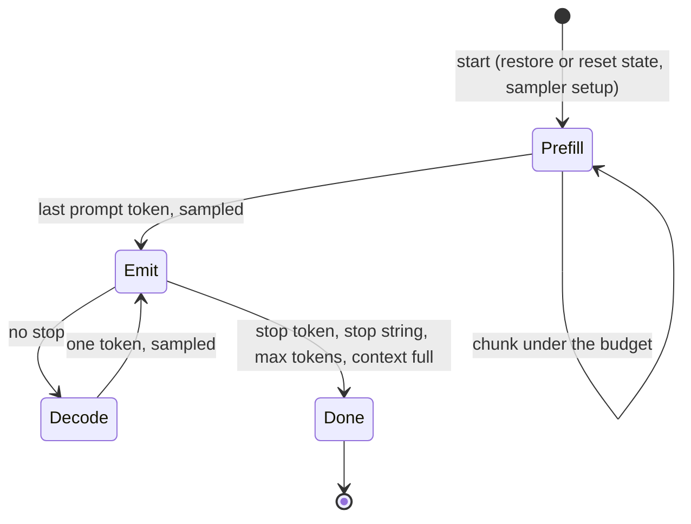

# Generation

M2 turns the GPU forward pass into text generation: an engine that schedules
steps under a time budget, keeps the model's state between requests, samples
on the GPU, and streams text. `zllm chat` and `zllm generate` drive it on the
Dawn host.

```sh
zllm chat model.gguf                        # thinking on; --no-think to skip it
zllm chat model.gguf --system "Be brief." --temperature 0.7
zllm generate model.gguf "Once upon a time" --max-tokens 200 --seed 1
scripts/d3d12.sh chat 'C:\path\to\model.gguf'   # on the Windows GPU, from WSL
```

## Engine

`src/sched/sched.zig` is a state machine that never blocks. Its host calls
`start` with a request, then repeatedly `next`, which returns one of three
events:

- **`submit`:** execute this batch, then call `complete` with the elapsed time.
- **`token`:** a sampled token and the text it released.
- **`done`:** the finish reason (`stop` or `length`) and usage.

The native host executes each batch synchronously. The browser host (M3)
will resolve the same batches asynchronously.



## Scheduling

Every submission is one step, and every step aims for the spec's 150 ms
budget:

- **Prefill:** a chunk is the largest token count whose predicted cost fits
  90% of the budget, at most 512. The prediction is linear,
  fixed + per_token · m:
  - **Fixed part:** measured on one-token steps. Before the first request,
    the host runs two calibration steps on a scratch state; the first only
    warms up the pipelines.
  - **Per-token part:** taken from the latest prefill step, because it grows
    with position (attention). That growth is also why the target is 90%.
  - **Ramp:** a chunk grows at most 4× past the step its rate came from,
    since the rate also rises with the chunk size. The first chunk is 64
    tokens.
- **Slow GPUs:** where a one-token step alone takes more than half the
  budget, smaller chunks would only add steps that each pay that cost. The
  target becomes twice the fixed cost instead. On llvmpipe, where one step
  costs about a second, the plain rule cut chunks to one or two tokens.
- **Checkpoint boundaries:** chunks also end at multiples of 512 and just
  before the prompt's last token. That token then runs as its own step, which
  measures the fixed cost and produces the logits to sample.
- **Decode:** one token per step. The sampler writes the token straight into
  the next step's input on the GPU, so the CPU only reads back the token id
  and its stop flag.

## State and prefix reuse

The resident sequence is every token the GPU has processed. The KV cache
holds their rows, and the DeltaNet state is the state after the last one.
`src/state/state.zig` decides how much of a new prompt to reuse:

| Case | Action | Prefill |
|---|---|---|
| The resident sequence is a prefix of the prompt | Continue from the current state | The rest of the prompt |
| They share a prefix | Restore the latest checkpoint inside it | From the checkpoint |
| Nothing usable, or no resident sequence | Zero the DeltaNet state | The whole prompt |

- **Rewinding:** attention rows rewind for free, since rows past the
  sequence are never read. The DeltaNet state cannot rewind, so the engine
  copies it into one of 4 checkpoint slots every 512 tokens and just before
  each prompt's last token, evicting the oldest slot when all are full.
- **The last-token checkpoint:** it serves three cases with one replayed
  token: regenerating the same prompt, editing what follows it, and
  continuing a conversation whose reply was re-rendered differently.

Reuse is exact. A reused prefix gives logits bitwise identical to processing
the whole prompt from scratch ([Validation](validation.md#engine)).

KV is one contiguous f16 cache per attention layer, sized for the context
(8192 tokens by default, 12 KiB per token for the 0.8B model). The spec's
256-token pages matter once several sequences share a pool, which a
single-sequence engine doesn't need.

## Sampling

The sampler (`src/kernels/sample.wgsl`) follows vLLM's v1 sampler
(`vllm-project/vllm@0c81a03`, `vllm/v1/sample/sampler.py`) step for step:

1. Logit bias.
2. Penalties:
   - Repetition: over prompt and output tokens, a logit l becomes l / r if
     positive, else l · r.
   - Frequency and presence: over output tokens only, l −= frequency · count
     + presence · [count > 0].
3. Greedy argmax (first index) if the temperature is below 1e-5.
4. Temperature.
5. Min-p: drop p < min_p · p_max.
6. Top-k: keep values ≥ the k-th largest.
7. Top-p: keep a token while the probability ranked above it is < p.
8. The draw.

Each filter keeps a top segment of the values, so the kernel tracks one
threshold on order-preserving keys and finds it by bisection, without
sorting. Stop tokens are checked on the GPU. Two differences from vLLM, both
deliberate:

- **Ties:** tokens tied at a top-k or top-p threshold are all kept. vLLM
  splits them by sort order.
- **Draw:** an inverse CDF in token-id order at one uniform u per step, drawn
  on the CPU from the request's seed. vLLM uses an exponential race, so
  seeded streams differ.

`src/sampler/sampler.zig` holds the request parameters, with vLLM's range
checks, and a CPU reference sampler that `gpu-check` compares the kernel
against.

## Chat format

`zllm chat` formats conversations with the fixed Qwen chat template,
[froggeric/Qwen-Fixed-Chat-Templates](https://huggingface.co/froggeric/Qwen-Fixed-Chat-Templates)
@ `855bffc4`, v22.5. `src/chat/chat.zig` transcribes it for text
conversations without tools, including:

- **Thinking control:** the `enable_thinking` and `reasoning_effort`
  options, and `<|think_off|>`-style tags in system and user messages.
- **Reasoning:** split out of earlier replies or passed separately.
- **System prompts:** leading system messages merged into one.
- **Whitespace:** trimmed like Python's `str.strip`.

`check-chat` compares the transcription with the Jinja template, rendered as
Hugging Face `transformers` renders it.

The template keeps earlier turns' reasoning (`preserve_thinking`), which
matters for reuse. Each new prompt re-renders the previous reply exactly as
the model generated it, so the whole conversation stays resident, and a turn
prefills only the new message. The stock Qwen template drops old reasoning,
which would force recomputing every earlier reply.

Text streams through `src/tokenizer/stream.zig`. It holds back bytes until
they form complete UTF-8 and cannot be the start of a stop string. The stop
string itself is not output, as in vLLM by default.

`chat` defaults to the Qwen 3.5 model card's text-task sampling:

| Mode | Temperature | top_p | top_k | Presence penalty |
|---|---|---|---|---|
| Thinking | 1.0 | 0.95 | 20 | 1.5 |
| `--no-think` | 1.0 | 1.0 | 20 | 2.0 |

`generate` samples plainly unless told otherwise, as vLLM does for a model
without a `generation_config.json`.

## Performance baseline

Measured with `zllm chat` and `zllm generate` on an RTX 5090 Laptop (D3D12),
f16 KV:

| Phase | Rate |
|---|---|
| Prefill, a 2,457-token prompt | 1,562–1,567 tok/s over two runs; the longest step 146 ms |
| Decode, greedy, short context | 34 tok/s (29 ms per token) |
| Decode, greedy, after the 2,457-token prompt | 27 tok/s (37 ms per token) |
| Decode, top-k 20 + top-p 0.95 | 25 tok/s (40 ms per token) |

The fixed cost of a step is 26 ms. The first step after loading took 70 ms
before calibration discarded it, and one early version of the cost model,
fed that figure, overshot to 288 ms steps.

Correctness came first, and the kernels are the M1 kernels made stateful.
Decode is far from what this GPU can do, for two known reasons that M4's
kernel catalog and tuning address:

- **Forward at one token:** the matrix multiply is tiled for prefill. At one
  token it runs few workgroups with long serial loops. The spec's
  matrix-vector decode kernel and decode-specific DeltaNet path replace it.
- **Sampler:** each top-k or top-p bisection sweeps the 248k-entry
  vocabulary in a single workgroup, about 150 µs per sweep. Selecting
  candidates across many workgroups first removes most of those sweeps.
