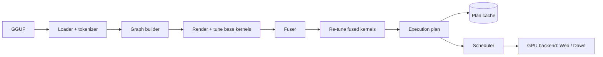

# zllm spec (v0.1 draft)

## 1. Scope
**Goal:** single-user LLM inference on WebGPU from one Zig codebase. The same core runs in the browser (wasm32-freestanding with a thin JS shim) and natively on Dawn for tests. It takes GGUF models, generates WGSL kernels from templates, autotunes and fuses them per GPU and model, and streams tokens out through an OpenAI-style interface.

**Not in v1:** training, more than one sequence at a time, multiple GPUs, vision or audio, grammar-constrained decoding, a CPU inference path (the CPU path is a test reference only).

| Target | v1 bar |
|---|---|
| Models | Qwen 3.5/3.6/3.8 hybrid (Gated DeltaNet + full attention), 0.8B–27B. Llama and Qwen3 dense in v1.1 |
| Quantization | GGUF Q3_K, Q4_K, Q5_K, Q6_K, Q8_0, F16, BF16 |
| Platforms | Chrome/Edge WebGPU on D3D12, Metal and Vulkan; Dawn native |
| Performance (27B Q3_K, RTX 5090 Laptop, Chrome) | decode ≥ 20 tok/s (WebLLM: ~15); prefill ≥ 300 tok/s; warm load ≤ 40 s |
| GPU safety | no submission over 250 ms; zero device hangs in a soak test |

## 2. Pipeline



## 3. Components
| Module | Job |
|---|---|
| gguf | Header, metadata and tensor index. Streams weights: HTTP range reads or OPFS in the browser, mmap natively. Splits tensors into GPU buffers within maxStorageBufferBindingSize. |
| tokenizer | Built from GGUF tokenizer.ggml.*: byte-level BPE and SentencePiece, added and special tokens, per-model pre-tokenizer regex. |
| graph | Builds the op graph from GGUF architecture metadata: layer types, heads, dims, DeltaNet params, RoPE variant. |
| tmpl | Handlebars-subset renderer written in Zig. |
| kernels/*.wgsl.hbs | Kernel templates, each with a parameter schema and cost model. |
| tune | Load-time sweeps. |
| fuse | Graph fusion pass. |
| plan | Buffers, pipelines, bind groups, step programs, time budgets. |
| sched | Builds submissions under the time budget. |
| state | KV pages, DeltaNet state, checkpoints. |
| sampler | GPU sampling. |
| gpu | Backend interface, with web (JS imports) and dawn (webgpu.h) backends. |
| api | C ABI and wasm exports, plus the JS facade zllm.js. |

**Async model:** the Zig core is a state machine. It emits commands (create, write, dispatch, submit, readback) and consumes completions. There is no blocking and no Asyncify. The browser backend resolves promises; the Dawn backend may block.

## 4. Kernel templates
- **Syntax:** `{{x}}`, `{{#if}}`/`{{else}}`, `{{#each}}`, `{{#range a b}}`, partials `{{> dequant_q4k}}`, and helpers (add, mul, ceil_div, vec_type, enable). No arbitrary code.
- **Each kernel has:** a template, a parameter schema (types, ranges, constraints checked against device limits), a cost model (FLOPs, bytes), and a reference variant. Shapes go in uniforms; parameters are baked into the WGSL.
- **Catalog:** quantized matrix-vector (decode), tiled quantized matmul (prefill), paged GQA attention (head_dim 256, split-K), chunked DeltaNet scan with conv1d, gates and L2 norm, RMSNorm, partial/mrope RoPE, SiLU-mul, residual, embedding gather, lm_head with top-k, and the sampler.

## 5. Tuning
- **When:** after the user picks a model and its weights are on the GPU. A cache hit skips it.
- **Candidates:** at most 12 per kernel × model shape, taken from a vendor rules table plus neighbouring configs, pruned against device limits.
- **Measurement:** 3 warm-up runs, then the median of 7. Uses timestamp queries, or batched onSubmittedWorkDone timing if the adapter has none.
- **Correctness first:** every candidate is checked against the reference with per-quant tolerances. Losers and diverging candidates are dropped.
- **Outputs:** the winning parameters plus the measured cost in µs, which the scheduler uses. The sweep is budgeted to about 60 s and shown as a progress phase.

## 6. Fuser
Rules for the Qwen hybrid model:
- RMSNorm into the next matrix-vector or matmul prologue.
- Gate and up projections plus SiLU-multiply as one kernel.
- Residual add into the down and output projection epilogues.
- RoPE plus the KV-cache write into the QKV epilogue.
- DeltaNet: conv1d, gates and L2 norm before the scan; norm and gating after it.
- Final norm, lm_head and top-k together.

A fusion is legal only if it needs no cross-workgroup sync and fits the device limits. Fused kernels are re-tuned and checked layer by layer against the unfused version.

## 7. Execution plan and cache
- **Plan contents:** buffer layout, pipelines, prebuilt bind groups, step programs (prefill(N) and decode), and per-step costs. Decoding a token replays a prebuilt dispatch list; the only per-token work is a uniform write.
- **Cache key:** a hash of adapter info, limits and features; browser or Dawn version; the model (GGUF header plus tensor index); the zllm version; and the template set.
- **Stored:** tuned parameters, the fusion plan, and the WGSL. Pipelines are rebuilt asynchronously and in parallel on load. Storage is IndexedDB or OPFS in the browser and a file next to the model natively.

## 8. Scheduler
- **Budget:** 150 ms target per submission, 250 ms hard cap.
- **Prefill:** each chunk is the largest token count whose predicted cost fits the budget.
- **Decode:** one token per submission. Only the sampled token id comes back, plus optional logprobs.
- **Overlap:** the CPU encodes the next submission while the GPU runs the current one.
- **Device lost:** a typed error, then the engine rebuilds from the plan cache.

## 9. State and prefix reuse
- **Attention layers:** paged f16 KV with 256-token pages. Rewinding drops the pages past the shared prefix.
- **DeltaNet layers:** the recurrent state (K×V per head, f32) plus the conv state. These can't be rewound, so the engine saves checkpoints at the end of each prompt segment and every 512 tokens, keeping a ring of the last few.
- **Reuse:** find the longest common token prefix with the resident sequence, restore the nearest checkpoint at or before it, and prefill only the rest.

## 10. Sampling (GPU)
- **Controls:** temperature, top-k, top-p, min-p, repetition/presence/frequency penalties, logit bias and seed.
- **Stops:** stop tokens on the GPU. Stop strings are checked on the CPU against the decoded tail.

## 11. API

```ts
const engine = await zllm.load({ model, cache: true, onProgress });  // model: URL | FileSystemFileHandle
for await (const ev of engine.generate({ prompt /* or tokens */, maxTokens, sampling, stop, signal })) { /* {text, tokens, finish?, usage?} */ }
engine.chat.completions.create(request); // OpenAI chunks; renders the GGUF chat template (overridable, e.g. fixed Qwen) via @huggingface/jinja; XML/JSON tool parsers
engine.tokenize(text); engine.detokenize(ids); engine.interruptGenerate(); engine.unload(); engine.stats();
```

The C ABI is zllm_load, zllm_generate (event stream), zllm_cancel, zllm_unload and zllm_stats. The engine is a drop-in engineFactory for packages/web_llm. The raw conversation-template workaround goes away, because generate takes text and reuses prefixes itself.

## 12. Validation
- **Tokenizer:** 100% match with Hugging Face tokenizers on a test corpus.
- **Kernels:** unit tests of every variant against a CPU f32 reference written in Zig, run on Dawn, plus property tests over the parameter grid.
- **Model:** layer-by-layer comparison with llama.cpp. Hidden-state cosine similarity ≥ 0.999 and top-1 token agreement ≥ 99% on an eval set.
- **GPU safety:** soak tests on integrated and discrete GPUs that assert the maximum submission time.
- **Benchmarks:** JSON results per device.

## 13. Milestones
1. **M0:** GGUF reader, tokenizer and CPU reference forward pass for the 0.8B model.
2. **M1:** Dawn backend and core kernels at parity.
3. **M2:** scheduler, state and sampler; a native command-line chat.
4. **M3:** wasm build, JS shim and browser streaming.
5. **M4:** templates, tuning and plan cache.
6. **M5:** fuser.
7. **M6:** the 27B on the 5090 meets the bar.
8. **M7:** Llama and Qwen3 dense models, and speculative decoding with Qwen3.8's MTP heads (its GGUFs include them).

**Deferred decisions:** KV page size; f16 vs f32 accumulation per vendor; OPFS vs IndexedDB for the weight cache; caching compiled pipeline binaries on Dawn native, which the browser doesn't expose.
